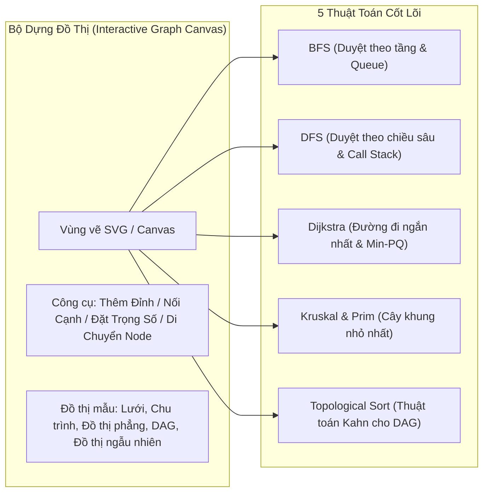
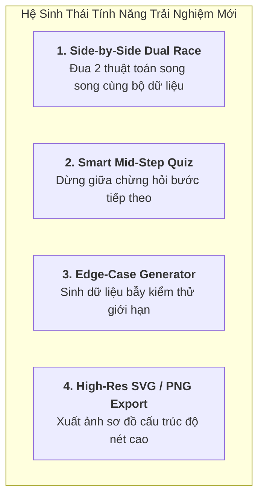

# 🚀 BẢN KẾ HOẠCH TỔNG THỂ MỞ RỘNG TOÀN DIỆN HỆ THỐNG DSA VISUALIZER
## (DSA Visualizer Master Expansion & Completion Roadmap)

---

> **Tài liệu tham chiếu dự án**: `DSA Visualizer – Mô phỏng thuật toán trực quan`  
> **Nguyên tắc cốt lõi**:
> 1. **Zero External Dependencies**: 100% Vanilla JavaScript (ES Modules), CSS3 Variables/Flex/Grid, Native Vector SVG & Canvas, Web Audio API.
> 2. **Bảo toàn 100% hệ thống hiện có**: Giữ nguyên vẹn độ mượt mà, tính chuẩn xác của 15 thuật toán/cấu trúc dữ liệu đã triển khai (Sắp xếp, Tìm kiếm, Stack, Queue, Singly Linked List, BST, AVL Tree, Min/Max Heap).
> 3. **Tính tương tác sâu (Interactive First)**: Mọi cấu trúc dữ liệu mới đều có bảng điều khiển tùy biến, chế độ tự thao tác từng bước (Play/Pause/Step-by-step), hiệu ứng âm thanh (Web Audio API), chế độ Thực hành (Practice Mode), xuất báo cáo vết (Trace Table & PDF A4).

---

## 🗺️ TỔNG QUAN BẢN ĐỒ KIẾN THỨC TOÀN DIỆN (DSA MASTER TAXONOMY)

```mermaid
graph TD
    Root["<b>DSA Visualizer (Bách Khoa DSA)</b>"]
    
    Root --> LinearGroup["<b>1. Cấu Trúc Tuyến Tính</b>"]
    LinearGroup --> SLL["Singly Linked List (Đã có)"]
    LinearGroup --> DLL["⭐ Doubly Linked List (DSLK Đôi)"]
    LinearGroup --> CLL["⭐ Circular Linked List (DSLK Vòng)"]
    LinearGroup --> StackQueue["Stack & Queue (Đã có)"]
    LinearGroup --> Deque["⭐ Deque (Double-Ended Queue)"]

    Root --> TreeGroup["<b>2. Cấu Trúc Phân Cấp & Cây</b>"]
    TreeGroup --> BSTAVLHeap["BST, AVL Tree, Heap (Đã có)"]
    TreeGroup --> Trie["⭐ Trie (Prefix Tree & Autocomplete)"]
    TreeGroup --> SegTree["⭐ Segment Tree (Range Query)"]

    Root --> HashGroup["<b>3. Bảng Băm (Hash Table)</b>"]
    HashGroup --> HashChaining["⭐ Separate Chaining (Nối chuỗi DSLK)"]
    HashGroup --> HashOpen["⭐ Open Addressing (Linear & Quadratic Probing)"]

    Root --> GraphGroup["<b>4. Đồ Thị (Graph DS & Algorithms)</b>"]
    GraphGroup --> GraphCanvas["⭐ Interactive Graph Canvas (Kéo-thả đỉnh/cạnh)"]
    GraphGroup --> GraphTraverse["⭐ BFS & DFS (Duyệt theo chiều rộng/sâu)"]
    GraphGroup --> ShortestPath["⭐ Dijkstra (Đường đi ngắn nhất)"]
    GraphGroup --> MST["⭐ Kruskal & Prim (Cây khung nhỏ nhất)"]
    GraphGroup --> TopoSort["⭐ Topological Sort (Sắp xếp tô-pô DAG)"]

    Root --> AdvancedAlgo["<b>5. Thuật Toán Nâng Cao & Tối Ưu</b>"]
    AdvancedAlgo --> Backtrack["⭐ N-Queens (Quay lui bàn cờ)"]
    AdvancedAlgo --> DP["⭐ 0/1 Knapsack (Ma trận Quy hoạch động 2D)"]

    Root --> UltimateFeatures["<b>6. Tính Năng Trải Nghiệm Đỉnh Cao</b>"]
    UltimateFeatures --> DualRace["⭐ Side-by-side Dual Race (Đua thuật toán đối đầu)"]
    UltimateFeatures --> QuizMode["⭐ Interactive Mid-Step Quiz (Câu đố thông minh)"]
    UltimateFeatures --> EdgeCase["⭐ Edge-Case Generator (Sinh dữ liệu bẫy/ngoại lệ)"]
```



---

## 📋 CHI TIẾT 5 GIAI ĐOẠN TRIỂN KHAI (PHASED EXECUTION PLAN)

### ═════════════════════════════════════════════════════════════════
### GIAI ĐOẠN 1: DOUBLY LINKED LIST & CẤU TRÚC TUYẾN TÍNH MỞ RỘNG
### ═════════════════════════════════════════════════════════════════

#### 1. Doubly Linked List (Danh sách liên kết đôi / kép)
* **Ý nghĩa học thuật**: Mỗi phần tử là một node có 3 trường con trỏ/dữ liệu: con trỏ `prev` trỏ về node liền trước, dữ liệu `data`, và con trỏ `next` trỏ tới node liền sau. Cho phép duyệt 2 chiều hiệu quả $O(1)$ tại cả hai đầu `Head` và `Tail`.
* **Thiết kế Node trực quan**:
  ```text
  ┌───────┬─────────┬───────┐      ┌───────┬─────────┬───────┐
  │ prev  │  DATA   │ next  │ ⇄⇄⇄  │ prev  │  DATA   │ next  │
  │ (◄──) │   42    │ (──►) │      │ (◄──) │   88    │ (──►) │
  └───────┴─────────┴───────┘      └───────┴─────────┴───────┘
  ```
  - Cấu trúc viên nang 3 khoang (3-chamber capsule): Khoang trái `prev` màu lục ngọc nhạt, khoang giữa `data` số to sắc nét, khoang phải `next` màu xanh dương nhạt.
  - Mũi tên 2 chiều: Mũi tên trên màu xanh Cyan trỏ sang phải (`next`), mũi tên dưới màu cam Amber trỏ sang trái (`prev`).
* **Trọn bộ 10 chức năng tương tác**:
  1. `➕ Chèn đầu (insertHead)`: Cập nhật `new_node.next = head; head.prev = new_node; head = new_node;`.
  2. `➕ Chèn đuôi (insertTail)`: Cập nhật `tail.next = new_node; new_node.prev = tail; tail = new_node;`.
  3. `📍 Chèn tại vị trí k (insertAt)`: Duyệt tới vị trí $k$, ngắt 2 cặp liên kết và chèn node mới vào giữa.
  4. `🗑️ Xóa đầu (deleteHead)` & `🗑️ Xóa đuôi (deleteTail)`: Di chuyển con trỏ `head` hoặc `tail`, giải phóng node.
  5. `🗑️ Xóa giá trị x (deleteVal)`: Tìm node có giá trị $x$, tự động bắc cầu `node.prev.next = node.next` và `node.next.prev = node.prev`.
  6. `🔍 Tìm kiếm x (search)`: Highlight con trỏ quét từng node kèm âm thanh synth.
  7. `➡️ Duyệt xuôi (Forward Traversal)`: Di chuyển vệt sáng từ `Head` sang `Tail`.
  8. `⬅️ Duyệt ngược (Backward Traversal)`: Di chuyển vệt sáng từ `Tail` về `Head` (làm nổi bật lợi thế vượt trội của DLL so với SLL).
  9. `🔄 Đảo ngược danh sách (Reverse DLL)`: Diễn hoạt tráo đổi cặp con trỏ `prev` và `next` của từng node từ đầu đến cuối danh sách.
  10. `🎲 Tạo danh sách ngẫu nhiên`, `🧹 Xóa rỗng`.

#### 2. Circular Linked List (Danh sách liên kết vòng)
* **Trực quan hóa**: Node `Tail` cuối cùng có mũi tên SVG uốn cong dạng cánh cung (curved bezier arc) vòng ngược lại trỏ vào `Head`.
* **Ứng dụng minh họa**:
  - Thuật toán lập lịch luân phiên **Round-Robin CPU Scheduling**.
  - Bài toán kinh điển **Josephus Problem** (loại người thứ $k$ theo vòng tròn cho đến khi còn lại 1 người duy nhất).

#### 3. Deque (Double-Ended Queue / Hàng đợi hai đầu)
* **Trực quan hóa**: Ống nằm ngang mở cả hai đầu (Front và Rear).
* **Thao tác**: `pushFront(x)`, `pushBack(x)`, `popFront()`, `popBack()`, `peekFront()`, `peekRear()`.
* **Ứng dụng trực quan**:
  - Kiểm tra xâu đối xứng (**Palindrome Checker**): Lấy đồng thời ký tự đầu và cuối so khớp.
  - Cửa sổ trượt tìm giá trị lớn nhất (**Sliding Window Maximum**).

---

### ═════════════════════════════════════════════════════════════════
### GIAI ĐOẠN 2: BẢNG BĂM (HASH TABLE & VA CHẠM BĂM)
### ═════════════════════════════════════════════════════════════════

#### 1. Cơ chế băm & Giao diện bảng Buckets
* **Hàm băm trực quan**:
  $$\text{index} = \text{hash}(key) = (\text{key} \bmod M)$$
  *(Với $M$ là kích thước bảng, mặc định $M = 7$ hoặc $11$ - số nguyên tố).*
* **Hiển thị hộp tính toán thời gian thực**: Khi người dùng nhập khóa $k = 45$, một bảng công thức nhảy số nổi lên: `45 mod 7 = 3 ➔ Bucket #3`.

#### 2. Kỹ thuật 1: Separate Chaining (Băm nối chuỗi DSLK)
* **Giao diện**:
  - Cột dọc bên trái: Mảng các ô Bucket từ $0 \dots M-1$.
  - Hàng ngang bên phải: Mỗi ô bucket là gốc của một danh sách liên kết. Nếu có va chạm (Collision), node mới được nối vào danh sách tại bucket đó.
* **Mô phỏng thao tác**:
  - `Insert(key, value)`: Tính bucket, nếu ô rỗng ➔ tạo node đầu; nếu đã có phần tử ➔ nối chuỗi, hiển thị cảnh báo `⚡ Collision tại Bucket i!`.
  - `Search(key)`: Trỏ tới bucket, sau đó duyệt từng node trên chuỗi liên kết để tìm khóa.
  - `Delete(key)`: Tìm và ngắt liên kết node khỏi chuỗi.

#### 3. Kỹ thuật 2: Open Addressing (Địa chỉ mở / Thử tuyến tính & Bậc 2)
* **Linear Probing (Thử tuyến tính)**:
  $$h(k, i) = (h(k) + i) \bmod M \quad (i = 0, 1, 2, \dots)$$
  - Khi ô bị chiếm, con trỏ nhảy sang ô kế tiếp $+1, +2, \dots$ cho đến khi gặp ô trống.
  - Trực quan hóa hiện tượng **Tụ cụm sơ cấp (Primary Clustering)**.
* **Quadratic Probing (Thử bậc hai)**:
  $$h(k, i) = (h(k) + c_1 i + c_2 i^2) \bmod M$$
  - Hiển thị bước nhảy parabol mở rộng để hạn chế tụ cụm.
* **Quản lý trạng thái 3 màu của ô**:
  - `Trống (EMPTY)`: Màu xám viền nét đứt.
  - `Đang chứa (OCCUPIED)`: Màu xanh lam nổi bật.
  - `Đã xóa (DELETED / Tombstone)`: Màu cam nhạt có ký hiệu `✝` - Giúp người dùng hiểu sâu tại sao không được gán rỗng ô khi xóa trong Open Addressing!
* **Hệ số tải (Load Factor $\alpha = N / M$) & Rehash tự động**:
  - Thanh đo tỉ lệ lấp đầy (Progress bar $\alpha$). Khi $\alpha \ge 0.7$, kích hoạt hoạt ảnh **Rehashing**: Tạo bảng mới kích thước $2M + 1$, tính lại hash và di chuyển mượt mà toàn bộ phần tử sang bảng mới.

---

### ═════════════════════════════════════════════════════════════════
### GIAI ĐOẠN 3: ĐỒ THỊ TRỰC QUAN & GIẢI THUẬT ĐỒ THỊ (GRAPH CANVAS)
### ═════════════════════════════════════════════════════════════════



#### 1. Interactive Graph Canvas (Bộ dựng đồ thị tương tác đỉnh cao)
* **Thao tác chuột mượt mà**:
  - `Click ô trống`: Thêm đỉnh mới ($A, B, C, \dots$).
  - `Kéo chuột từ Đỉnh 1 sang Đỉnh 2`: Tạo cạnh nối. Hộp nhập liệu hiện nhanh cho phép gõ trọng số (Weight) và chọn hướng (Vô hướng / Có hướng).
  - `Kéo thả đỉnh (Drag & Drop)`: Di chuyển vị trí đỉnh bất kỳ, các cạnh tự động co giãn theo tọa độ thời gian thực.
  - `Nút xóa`: Nhấp chọn đỉnh/cạnh rồi bấm Delete.
* **Bảng biểu diễn đồ thị song song**:
  - Tab chuyển đổi xem: **Ma trận kề (Adjacency Matrix)** $\leftrightarrow$ **Danh sách kề (Adjacency List)**. Khi thuật toán duyệt qua cạnh nào, ô ma trận tương ứng được highlight chớp sáng.

#### 2. Thuật toán Duyệt: BFS & DFS
* **BFS (Breadth-First Search)**:
  - Khung phụ trợ: Hiển thị thanh **Hàng đợi (Queue)** bên cạnh.
  - Hiệu ứng sóng lan tỏa (Ripple ripple wave): Các đỉnh được tô màu theo số tầng (Khoảng cách $d = 0, 1, 2, \dots$).
* **DFS (Depth-First Search)**:
  - Khung phụ trợ: Hiển thị **Ngăn xếp cuộc gọi (Recursion Call Stack)**.
  - Hiệu ứng đi sâu tới khi hết đường, sau đó hiển thị con trỏ rút lui (Backtrack) màu tím lấp lánh về đỉnh trước.

#### 3. Thuật toán Dijkstra (Đường đi ngắn nhất)
* **Bảng theo dõi trạng thái**:
  - Cột: Đỉnh $v$ | Khoảng cách $dist[v]$ | Đỉnh trước $prev[v]$ | Trạng thái (Chưa xét / Đang trong Hàng đợi / Đã chốt tối ưu).
* **Diễn hoạt từng bước**:
  - Lấy đỉnh $u$ có $dist[u]$ nhỏ nhất ra khỏi Priority Queue.
  - Duyệt các đỉnh kề $v$, thực hiện bước **Tối ưu hóa cạnh (Edge Relaxation)**:
    $$\text{Nếu } dist[u] + w(u, v) < dist[v] \implies dist[v] = dist[u] + w(u, v)$$
  - Sau khi kết thúc, đường đi ngắn nhất từ đỉnh nguồn đến đỉnh đích được viền sáng Neon Gold rực rỡ, các cạnh không thuộc đường đi làm mờ nhẹ.

#### 4. Cây khung nhỏ nhất (MST - Kruskal & Prim)
* **Kruskal Algorithm**:
  - Bảng danh sách tất cả các cạnh sắp xếp tăng dần theo trọng số.
  - Duyệt từng cạnh: Dùng **Cấu trúc tập hợp rời rạc (DSU - Disjoint Set Union)** kiểm tra `find(u) == find(v)`.
  - Nếu tạo chu trình: Cạnh chớp đỏ báo hiệu `❌ Bị bỏ qua vì tạo chu trình!`.
  - Nếu không tạo chu trình: Cạnh chuyển xanh lục `✅ Thêm vào MST`.
* **Prim Algorithm**:
  - Chọn đỉnh xuất phát, luôn tìm cạnh nối nhỏ nhất giữa tập đỉnh đã kết nạp và tập đỉnh bên ngoài.

#### 5. Topological Sort (Sắp xếp Tô-pô)
* Áp dụng trên đồ thị có hướng không chu trình (DAG).
* Trực quan hóa thuật toán **Kahn**:
  - Tính bán bậc vào (In-degree) của mọi đỉnh.
  - Đẩy các đỉnh có In-degree $= 0$ vào Queue.
  - Xóa đỉnh, giảm In-degree của các đỉnh kề, xuất kết quả ra thanh băng chuyền thứ tự thực hiện tác vụ (Task Dependency Order).

---

### ═════════════════════════════════════════════════════════════════
### GIAI ĐOẠN 4: CÂY NÂNG CAO, QUAY LUI & QUY HOẠCH ĐỘNG (DP)
### ═════════════════════════════════════════════════════════════════

#### 1. Trie (Prefix Tree - Cây Tiền Tố)
* **Bản chất**: Cây $k$-phân chuyên dụng lưu trữ tập hợp xâu ký tự (từ điển).
* **Trực quan hóa**:
  - Gốc `Root` rỗng, mỗi cạnh mang một chữ cái ($a \dots z$).
  - Các node kết thúc từ được đánh dấu chấm tròn viền đôi và đổi màu rực rỡ (`isEndOfWord = true`).
* **Tính năng tương tác độc đáo: Live Autocomplete Search Box**:
  - Khung tìm kiếm thời gian thực: Khi người dùng gõ từng chữ cái (Ví dụ: `a` ➔ `ap` ➔ `app`), vệt sáng trên cây Trie di chuyển theo từng ký tự tương ứng và hộp gợi ý bên dưới bung ra danh sách tất cả các từ có tiền tố đó (`apple`, `apply`, `application`).

#### 2. Segment Tree (Cây Phân Đoạn)
* **Ứng dụng**: Giải bài toán Range Sum Query ($RSQ$) và Range Minimum Query ($RMQ$) trong $O(\log n)$.
* **Trực quan song song**:
  - Hàng trên: Mảng dữ liệu gốc $A[0 \dots n-1]$.
  - Hàng dưới: Cây nhị phân hoàn chỉnh biểu diễn các đoạn $[L, R]$.
  - **Mô phỏng Range Query $[L, R]$**: Các node con bao trọn khoảng truy vấn được tô sáng màu xanh, kết quả tổng được cộng dồn trực quan.
  - **Mô phỏng Point Update $A[i] = v$**: Thay đổi giá trị tại ô lá, các node cha trên đường đi ngược lên gốc (Bottom-up) tự động tính toán lại giá trị.

#### 3. Quay lui: N-Queens Problem (Bài toán Xếp 8 Quân Hậu)
* **Giao diện**: Bàn cờ vua sắc nét $N \times N$ ($N$ từ 4 đến 8 tùy chọn).
* **Logic trực quan hóa**:
  - Đặt từng quân Hậu $\text{Queen}_i$ vào hàng $i$.
  - Chiếu các **Tia Laser đỏ** biểu thị tầm kiểm soát: Hàng ngang, Cột dọc, và 2 Đường chéo chính/phụ.
  - Nếu gặp xung đột $\implies$ Rút quân về (Backtrack), thử cột tiếp theo.
  - Khung thống kê: Số cách xếp hợp lệ tìm được, số lần quay lui, và cây đệ quy không gian trạng thái.

#### 4. Quy hoạch động: 0/1 Knapsack (Bài toán Ba Lô)
* **Giao diện**:
  - Danh sách đồ vật: Bảng gồm Tên món đồ, Khối lượng ($w_i$), Giá trị ($v_i$).
  - **Bảng ma trận phương án 2D** kích thước $(n+1) \times (W+1)$:
    Hàng biểu thị xét đến món đồ $i$, Cột biểu thị sức chứa ba lô $w$.
* **Công thức truy hồi trực quan hóa bằng 2 con trỏ**:
  $$DP[i][w] = \begin{cases} 
  DP[i-1][w] & \text{nếu } w_i > w \\ 
  \max\big(DP[i-1][w], \; DP[i-1][w-w_i] + v_i\big) & \text{nếu } w_i \le w 
  \end{cases}$$
  - Khi tính ô $DP[i][w]$, hệ thống vẽ 2 mũi tên cong chỉ rõ giá trị được lấy từ ô không chọn $DP[i-1][w]$ và ô có chọn $DP[i-1][w-w_i]$, giúp người học hiểu thấu đáo bản chất DP mà không cần tưởng tượng trừu tượng.
* **Hoạt ảnh Truy vết (Backtracking Solution)**:
  - Từ ô cuối cùng $DP[n][W]$, mũi tên lội ngược dòng ma trận để đóng gói chính xác danh sách những món đồ được chọn vào ba lô.

---

### ═════════════════════════════════════════════════════════════════
### GIAI ĐOẠN 5: ĐỈNH CAO TÍNH NĂNG TRẢI NGHIỆM NGƯỜI DÙNG
### ═════════════════════════════════════════════════════════════════



#### 1. Side-by-Side Dual Race (Chế độ So Sánh Song Song Đối Đầu)
* **Ý tưởng**: Chia đôi màn hình (Split View 50/50), cho phép người dùng chọn 2 thuật toán bất kỳ cùng phân nhóm để "chạy đua" trên cùng một bộ dữ liệu đầu vào.
* **Các cặp đấu kinh điển**:
  - 🏁 `Quick Sort` **VS** `Merge Sort` (Ai nhanh hơn trên mảng ngẫu nhiên vs mảng gần có thứ tự?)
  - 🏁 `Linear Probing` **VS** `Separate Chaining` (Đo số lần va chạm và độ trễ truy xuất)
  - 🏁 `BFS` **VS** `DFS` (Duyệt theo chiều rộng vs chiều sâu trên cùng đồ thị mê cung)
  - 🏁 `Binary Search Tree` **VS** `AVL Tree` (Cây thường bị lệch thành đường thẳng $O(n)$ vs Cây tự cân bằng $O(\log n)$)
* **Bảng chỉ số trực tiếp (Live Telemetry Dashboard)**:
  - Đồng hồ đếm số phép so sánh (Comparisons).
  - Số lần hoán đổi / gán (Swaps / Writes).
  - Thời gian thực thi phần cứng thực tế (Execution time ms).
  - Pháo hoa giấy (Confetti) và cúp vàng trao cho thuật toán hoàn thành trước.

#### 2. Smart Mid-Step Quiz (Chế độ Câu Đố Thông Minh Khi Đang Chạy)
* **Cơ chế**: Khi người dùng bật chế độ "Thử thách kiến thức", animation sẽ tự động tạm dừng tại các bước ngoặt quan trọng và bung ra câu hỏi trắc nghiệm nhanh:
  - *"Theo thuật toán Dijkstra, đỉnh tiếp theo được chọn từ Priority Queue là đỉnh nào?"*
  - *"Sau khi xoay Left-Right (LR) tại đỉnh 20, đỉnh nào sẽ trở thành gốc mới của cây con?"*
  - *"Khóa 53 khi chèn vào bảng băm size 11 bằng Linear Probing sẽ nằm ở vị trí nào sau va chạm?"*
* **Chấm điểm & Giải thích**: Có thanh điểm thưởng (Score / Streak), âm thanh trả lời đúng/sai và lời giải thích ngắn gọn, xúc tích.

#### 3. Edge-Case Generator (Bộ Sinh Dữ Liệu Bẫy / Trường Hợp Ngoại Lệ)
* Một nút bấm sinh nhanh các bộ dữ liệu kiểm thử ranh giới khắt khe:
  - **Mảng ngược hoàn toàn (Reverse sorted)**: Đẩy Quick Sort vào độ phức tạp tồi nhất $O(n^2)$.
  - **Mảng tất cả phần tử bằng nhau (All identical)**: Kiểm thử thuật toán có bị lặp vô hạn hay phân hoạch lệch không.
  - **Dãy tăng dần vào BST**: Khiến BST thoái hóa thành DSLK đơn.
  - **Khóa băm cùng giá trị mod**: Dồn toàn bộ va chạm vào duy nhất 1 bucket của Hash Table.

---

## 🛠️ KIẾN TRÚC MÃ NGUỒN DỰ KIẾN (FILE STRUCTURE BLUEPRINT)

```text
d:\Nam2_ky1\DSA\DSA Visualizer – Mô phỏng thuật toán\
├── index.html                           (Bổ sung container cho Dual Race, Graph Canvas, Hash Table)
├── DSA_EXPANSION_PLAN.md                (Bản kế hoạch tổng thể lưu tại gốc dự án)
├── css/
│   ├── tokens.css                       (Biến màu, khoảng cách chuẩn hóa)
│   ├── layout.css                       (Layout lưới chia đôi cho Dual Race, sidebar accordion)
│   └── components.css                   (CSS Node 3 ngăn DLL, Hash Bucket, Chessboard, DP Matrix)
├── js/
│   ├── state.js                         (Mở rộng quản lý state cho DLL, Hash, Graph, DP, Dual Race)
│   ├── player.js                        (Động cơ phát bước đồng bộ 2 luồng)
│   ├── renderer.js                      (Điều phối render các bộ trực quan hóa mới)
│   ├── ui.js                            (Xử lý sự kiện toolbar, modal, input, live autocomplete)
│   ├── audio.js                         (Bộ âm thanh synth)
│   ├── code-snippets.js                 (Mã nguồn C++, Java, Python, JS cho toàn bộ cấu trúc mới)
│   ├── export-trace.js                  (Bảng chạy tay & xuất PDF)
│   ├── dual-race.js                     (⭐ Động cơ so sánh song song đối đầu)
│   └── algorithms/
│       ├── index.js                     (Điểm đăng ký tập trung tất cả giải thuật)
│       ├── doublyLinkedList.js          (⭐ Module DSLK Đôi)
│       ├── circularLinkedList.js        (⭐ Module DSLK Vòng)
│       ├── deque.js                     (⭐ Module Deque)
│       ├── hashTable.js                 (⭐ Module Bảng Băm)
│       ├── graph.js                     (⭐ Core Đồ Thị: Đỉnh, Cạnh, Ma trận & Danh sách kề)
│       ├── graphBfs.js                  (⭐ BFS Đồ thị)
│       ├── graphDfs.js                  (⭐ DFS Đồ thị)
│       ├── dijkstra.js                  (⭐ Dijkstra Đường đi ngắn nhất)
│       ├── kruskal.js                   (⭐ Kruskal Cây khung nhỏ nhất MST)
│       ├── topoSort.js                  (⭐ Topological Sort)
│       ├── trie.js                      (⭐ Trie & Live Autocomplete)
│       ├── segmentTree.js               (⭐ Segment Tree)
│       ├── nQueens.js                   (⭐ N-Queens Backtracking)
│       └── knapsack.js                  (⭐ 0/1 Knapsack DP Matrix)
```

---

## 📅 LỘ TRÌNH VÀ THỨ TỰ THỰC THI (STEP-BY-STEP ROADMAP)

| Bước | Hạng Mục Công Việc | Các Tệp Tin Tác Động | Tiêu Chí Nghiệm Thu (Acceptance Criteria) |
| :---: | :--- | :--- | :--- |
| **BƯỚC 1** | **Doubly Linked List (DSLK Đôi)** | `doublyLinkedList.js`, `renderer.js`, `components.css`, `ui.js`, `code-snippets.js` | • Node hiển thị 3 khoang `[prev \| data \| next]` rõ đẹp.<br>• Hoạt ảnh mượt mà cho cả 10 thao tác.<br>• Duyệt ngược từ Tail về Head trơn tru.<br>• Có code mẫu 4 ngôn ngữ và trace table. |
| **BƯỚC 2** | **Circular Linked List & Deque** | `circularLinkedList.js`, `deque.js`, `renderer.js` | • Cung tên SVG uốn cong nối Tail về Head.<br>• Ống Deque 2 đầu nhận đẩy phần tử từ cả 2 phía. |
| **BƯỚC 3** | **Hash Table (Chaining & Open Addressing)** | `hashTable.js`, `renderer.js`, `components.css`, `ui.js` | • Bảng Buckets hiển thị rõ công thức mod.<br>• Chế độ Nối chuỗi & Dò tuyến tính/bậc 2.<br>• Cảnh báo Load Factor và hoạt ảnh Rehash. |
| **BƯỚC 4** | **Interactive Graph Canvas & BFS/DFS** | `graph.js`, `graphBfs.js`, `graphDfs.js`, `renderer.js` | • Người dùng tự do click tạo đỉnh, kéo nối cạnh, đặt trọng số.<br>• Diễn hoạt BFS tô màu theo tầng + Queue panel.<br>• Diễn hoạt DFS + Call Stack panel. |
| **BƯỚC 5** | **Dijkstra & Kruskal MST** | `dijkstra.js`, `kruskal.js`, `renderer.js` | • Bảng khoảng cách Dijkstra cập nhật từng bước relaxation.<br>• Cạnh MST đổi màu xanh lá khi không tạo chu trình. |
| **BƯỚC 6** | **Trie, N-Queens & Knapsack DP** | `trie.js`, `nQueens.js`, `knapsack.js`, `renderer.js` | • Ô gõ Autocomplete ăn khớp với nhánh Trie.<br>• Bàn cờ vua 8-Queens quét tia laser quay lui.<br>• Bảng ma trận DP 2D nối mũi tên 2 ô tiền thân. |
| **BƯỚC 7** | **Dual Race & Edge-Case Generator** | `dual-race.js`, `layout.css`, `index.html`, `ui.js` | • Chế độ chia đôi màn hình 2 thuật toán chạy đua mượt mà.<br>• Bảng thống kê so sánh đối đầu chi tiết. |

---

## 🎯 TIÊU CHÍ ĐẢM BẢO CHẤT LƯỢNG (QUALITY ASSURANCE CHECKLIST)

- [ ] **Tính nhất quán thẩm mỹ**: Mọi màu sắc dùng tokens (`--color-primary`, `--color-accent`, `--color-success`, `--color-danger`, `--color-surface`).
- [ ] **Đáp ứng đa kích thước (Responsive)**: Hoạt động trơn tru trên mọi độ phân giải màn hình từ Laptop 13" đến Desktop 4K.
- [ ] **Không giật lag (60 FPS)**: Sử dụng CSS Transitions phần cứng kết hợp `requestAnimationFrame`, không dùng các vòng lặp blocking.
- [ ] **Bảo toàn 100% mã nguồn cũ**: 15 thuật toán hiện tại tiếp tục hoạt động hoàn hảo, không bị ảnh hưởng hay xung đột trạng thái.
- [ ] **Đồng bộ hóa Git**: Toàn bộ thay đổi được commit sạch sẽ theo từng bước, có thông điệp commit rõ ràng và đồng bộ lên GitHub repository.
