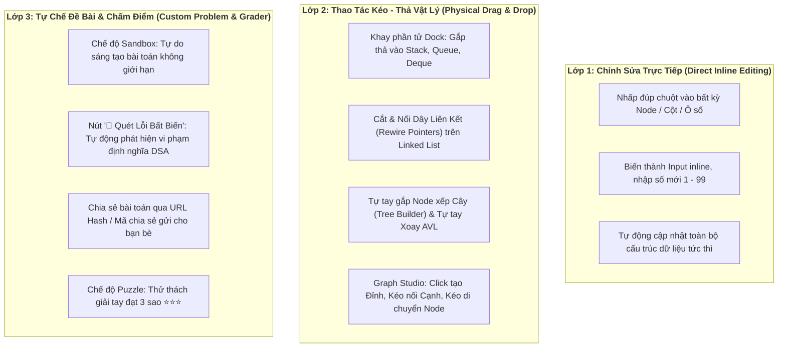

# 🔬 BẢN PHÂN TÍCH CHUYÊN SÂU TÍNH NĂNG TƯƠNG TÁC HAI CHIỀU & TỰ CUSTOM BÀI TOÁN
## (Comprehensive Analysis: Interactive Sandbox, Direct Editing & Custom Problem Builder)

---

> **Tài liệu chiến lược kỹ thuật** – Dự án `DSA Visualizer`  
> **Mục tiêu**: Chuyển đổi toàn diện trải nghiệm người dùng từ *mô phỏng quan sát thụ động (passive observation)* sang **môi trường thực nghiệm chủ động (active interactive sandbox)**, cho phép kéo-thả vật lý, chỉnh sửa trực tiếp trên canvas, tự giải bài toán và tự sáng tạo đề bài chia sẻ cho người khác.  
> **Nguyên tắc kỹ thuật**: 100% Native HTML5 Drag & Drop / Pointer Events, Vector SVG tương tác, Zero External Dependencies.

---

## 📐 I. KIẾN TRÚC TƯƠNG TÁC ĐỒNG BỘ (UNIFIED INTERACTION ARCHITECTURE)

Mọi cấu trúc dữ liệu và giải thuật trong hệ thống sẽ được quy chuẩn hóa về **3 lớp tương tác cốt lõi**:



---

## 🔍 II. PHÂN TÍCH CHI TIẾT TỪNG KHÂU KIẾN THỨC (DOMAIN-SPECIFIC ANALYSIS)

---

### 1. KHÂU CẤU TRÚC DỮ LIỆU TUYẾN TÍNH (LINEAR DATA STRUCTURES)
*(Stack, Queue, Deque, Singly Linked List, Doubly Linked List, Circular Linked List)*

#### A. Stack, Queue & Deque
1. **Khay chứa phần tử vật lý (Interactive Element Dock)**:
   - Thiết kế một dock ngang chứa các viên gạch số sinh sẵn hoặc ô nhập số kéo không giới hạn.
   - **Kéo thả Push / Enqueue**:
     - Người dùng dùng chuột gắp viên gạch số kéo vào vùng miệng ống. Vùng miệng ống chuyển viền nét đứt phát sáng xanh lục (`drag-over`).
     - Khi thả chuột, viên gạch có hoạt ảnh rơi vật lý mượt mà (`cubic-bezier(0.34, 1.56, 0.64, 1)`) xuống đáy Stack hoặc xếp vào đuôi Queue/Deque.
   - **Kéo thả Pop / Dequeue**:
     - Người dùng có thể cầm viên gạch ở đỉnh Top của Stack (hoặc Front/Rear của Deque) kéo vứt vào góc "Thùng rác thu hồi bộ nhớ 🗑️".
   - **Ràng buộc bất biến cứng (Invariant Enforcement)**:
     - Nếu người dùng cố tình kéo viên gạch ở giữa hoặc đáy Stack ra ngoài, gạch sẽ bị giật bật trở lại vị trí cũ kèm hiệu ứng rung lắc đỏ và âm thanh cảnh báo: *"Vi phạm LIFO! Chỉ được phép lấy phần tử ở đỉnh (Top)!"*.
2. **Chỉnh sửa giá trị trực tiếp (Inline Edit)**:
   - Nhấp đúp chuột vào bất kỳ phần tử nào trong ống để đổi giá trị từ 1 đến 99 ngay lập tức mà không cần tạo lại ống.

#### B. Họ Danh Sách Liên Kết (Singly, Doubly, Circular Linked List)
1. **Di chuyển Node tự do trên Canvas (Freeform Node Canvas)**:
   - Thay vì các Node bị ghim cứng vào một hàng ngang đơn điệu, người dùng có thể nhấp giữ chuột và **kéo thả di chuyển từng Node đến bất kỳ tọa độ $(x, y)$ nào**.
   - Các mũi tên vector SVG (`next` và `prev`) tự động tính toán lại góc xoay và độ dài theo tọa độ hai đầu Node theo thời gian thực ($60\text{ FPS}$).
2. **Cơ chế Cắt & Nối Dây Liên Kết (Rewire Pointers Sandbox)**:
   - Tích hợp 2 công cụ tương tác: **Cái kéo ✂️** và **Đầu dây cắm 🔗**:
     - **Cắt dây**: Nhấp công cụ Kéo vào một mũi tên để cắt đứt liên kết (mũi tên đứt gãy, biến mất, node sau trở thành mồ côi).
     - **Nối dây**: Nhấp vào khoang `next` hoặc `prev` của một Node, kéo một sợi dây cao su co giãn (rubber-band line) thả vào Node mục tiêu để thiết lập liên kết mới.
3. **Thử thách Đảo ngược Tự làm (Manual Reverse Challenge)**:
   - Hệ thống đưa ra một danh sách $A \to B \to C \to D$.
   - Người dùng phải tự tay cắt dây và nối ngược lại $D \to C \to B \to A$ và cắm cờ `HEAD` vào $D$. Bấm "Kiểm tra đáp án" để nhận điểm và pháo hoa.

---

### 2. KHÂU CÂY & ĐỐNG (TREES & HEAPS)
*(Binary Search Tree, AVL Tree, Min/Max Binary Heap)*

#### A. Cây Tìm Kiếm Nhị Phân (BST) & Cây AVL
1. **Trình Xây Cây Thủ Công (Tree Builder Sandbox)**:
   - Có một bảng chứa các Node tự do chưa được đưa vào cây.
   - Trên mỗi node hiện có của cây, xuất hiện 2 vùng thả mờ có ký hiệu `+` tại nhánh trái và nhánh phải.
   - Người dùng tự gắp từng Node kéo thả vào vị trí con trái hoặc con phải theo ý muốn.
   - **Trợ lý kiểm tra luật BST theo thời gian thực**:
     - Nếu thả một giá trị sai luật (ví dụ: thả số $40$ vào con trái của $30$), hệ thống sẽ báo đỏ và giải thích: *"Sai luật BST! Giá trị 40 > 30, chỉ được phép thả vào nhánh con phải!"*.
2. **Tự tay Xoay Cây AVL bằng chuột (Interactive Rotation Control)**:
   - Khi cây rơi vào trạng thái mất cân bằng ($|BF| \ge 2$), một biểu tượng bánh đà xoay (Rotation Wheel 🔄) hiện lên ngay tại đỉnh vi phạm.
   - Người dùng tự phân tích xem đó là trường hợp nào trong 4 phép xoay: $LL, RR, LR, RL$.
   - Người dùng bấm chọn hoặc cầm chuột xoay trực tiếp: Các node sẽ chuyển động trượt uốn lượn theo quỹ đạo hình cung tròn (circular arc path) về trạng thái cân bằng hoàn hảo.
3. **Thử thách Xóa Node 2 Con (Successor Replacement Puzzle)**:
   - Khi xóa một node có cả 2 con, hệ thống đố người dùng: *"Hãy tìm và kéo Node thế mạng phù hợp nhất lên thay thế!"*.
   - Người dùng phải tìm đúng Node nhỏ nhất ở cây con phải (Inorder Successor) hoặc lớn nhất ở cây con trái (Inorder Predecessor) kéo thả vào vị trí khuyết.

#### B. Đống Nhị Phân (Binary Heap)
1. **Tự tay Vun Đống (Interactive Sift-up & Sift-down)**:
   - Cung cấp một mảng số ngẫu nhiên lộn xộn.
   - Người dùng cầm chuột kéo đổi chỗ trực tiếp giữa Node cha và Node con để từng bước xây dựng đống hợp lệ (Max-Heap hoặc Min-Heap).
   - Hệ thống sẽ phát âm thanh tích xanh mỗi khi người dùng chọn đúng cặp cần đổi chỗ, và cảnh báo nếu người dùng chọn sai cặp con lớn hơn.

---

### 3. KHÂU BẢNG BĂM (HASH TABLE)
*(Separate Chaining & Open Addressing)*

1. **Thao tác Kéo Khóa vào Buckets (Manual Hashing)**:
   - Hiển thị mảng Buckets từ $0 \dots M-1$ cùng công thức $h(k) = k \bmod M$.
   - Người dùng tự tính nhẩm và kéo phần tử thả vào đúng ô Bucket. Nếu kéo thả sai ô, ô đó sẽ rung lắc từ chối tiếp nhận.
2. **Tự xử lý Va Chạm (Collision Resolution Sandbox)**:
   - **Chaining**: Người dùng tự tay kéo dây nối móc thêm node mới vào danh sách liên kết tại bucket bị trùng.
   - **Open Addressing**: Người dùng tự tay cầm phần tử trượt qua các ô tiếp theo $+1, +2 \dots$ để tìm ô trống đầu tiên (mô phỏng chính xác thuật toán dò tuyến tính).

---

### 4. KHÂU ĐỒ THỊ (GRAPH STUDIO)
*(BFS, DFS, Dijkstra, Kruskal, Prim, Topological Sort)*

1. **Studio Thiết Kế Đồ Thị Tự Do (Interactive Graph Canvas)**:
   - `Click chuột lên canvas trống`: Tạo đỉnh mới ($A, B, C, \dots$).
   - `Kéo chuột từ Đỉnh này sang Đỉnh khác`: Kẻ đường nối cạnh. Một popover nhỏ hiện ngay trên cạnh để người dùng gõ trọng số (Weight) và chọn cạnh có hướng hay vô hướng.
   - `Kéo thả đỉnh tự do`: Di chuyển các đỉnh để bố trí sơ đồ mạng lưới theo ý thích.
2. **Chế độ Tự Giải Giải Thuật Đồ Thị (Manual Graph Solver)**:
   - **Tự giải Dijkstra**: Bắt đầu từ đỉnh nguồn $S$, hệ thống cho hiển thị bảng khoảng cách tạm thời. Người dùng phải tự tay nhấp chuột vào đỉnh tiếp theo có khoảng cách nhỏ nhất trong Priority Queue để kích hoạt bước "Tối ưu hóa cạnh (Relaxation)".
   - **Tự giải Kruskal MST**: Người dùng tự tay nhấp chọn từng cạnh từ nhỏ nhất đến lớn nhất để kết nạp vào Cây khung nhỏ nhất. Nếu nhấp vào cạnh tạo thành chu trình, hệ thống lập tức báo lỗi và yêu cầu bỏ qua.

---

### 5. KHÂU THUẬT TOÁN SẮP XẾP & TÌM KIẾM (SORTING & SEARCHING)

1. **Tự chọn Pivot trong Quick Sort**:
   - Người dùng được phép nhấp chuột vào bất kỳ cột nào để chỉ định làm Pivot (Pivot đầu, Pivot cuối, Pivot giữa, hoặc Median-of-3).
   - Sau đó, người dùng tự tay kéo các cột nhỏ hơn gom về nửa trái và lớn hơn gom về nửa phải.
2. **Chia để trị thủ công trong Merge Sort**:
   - Người dùng nhấp chuột chia đôi mảng, sau đó tự tay so khớp và nhấc phần tử nhỏ hơn thả xuống mảng kết quả.
3. **Thám tử Tìm kiếm (Detective Binary Search)**:
   - Toàn bộ các ô số được úp mặt lại (dấu `?`).
   - Người dùng phải áp dụng chuẩn thuật toán Binary Search: Luôn lật ô ở chính giữa `Mid`. Dựa vào số hiện ra lớn hơn hay nhỏ hơn Target, người dùng bấm loại bỏ nửa trái hoặc nửa phải cho đến khi tìm thấy.

---

### 6. KHÂU TỰ CHẾ ĐỀ BÀI & CHIA SẺ BÀI TOÁN (CUSTOM SCENARIO BUILDER & SHARE)

1. **Bộ Tạo Đề Bài (Custom Scenario Builder)**:
   - Người dùng có thể tự vẽ một cây BST đặc thù, một đồ thị nhiều bẫy, hoặc một dãy số biên (Edge-case).
   - Nút **"💾 Lưu Đề Bài"**: Lưu trực tiếp vào `LocalStorage` của trình duyệt để lần sau mở lại.
2. **Chia Sẻ Đề Bài Bằng Liên Kết URL (Shareable URL Hash)**:
   - Toàn bộ dữ liệu của đề bài do người dùng tạo sẽ được mã hóa gọn gàng vào đường dẫn URL (URL Hash):  
     *Ví dụ*: `https://.../#mode=custom&algo=bst&data=50,20,80,10,35,70,95`
   - Bấm **"🔗 Sao chép liên kết chia sẻ"**: Người dùng có thể gửi link này cho bạn bè, giảng viên hoặc học viên để họ mở ra và giải đúng bài toán do mình thiết kế!
3. **Bộ Quét Lỗi Bất Biến Tự Động (Invariant Validator Bot)**:
   - Khi người dùng tự tay dựng xong một cấu trúc dữ liệu, có nút **"🤖 Kiểm Tra Tính Hợp Lệ"**:
     - Cây có đúng tính chất BST không?
     - Cây AVL có bị mất cân bằng ở node nào không?
     - Đồ thị có chứa chu trình âm hay đỉnh cô lập không?
     - Danh sách liên kết có bị rò rỉ bộ nhớ (node bị cô lập) không?

---

## 📅 III. LỘ TRÌNH THỰC HIỆN "LÀM ĐẾN ĐÂU CHẮC ĐẾN ĐÓ"

Để đảm bảo tính chỉn chu, mỗi khâu kiến thức sẽ được triển khai theo quy trình chuẩn 4 bước:

```text
[BƯỚC 1: Xây dựng Canvas & Bắt sự kiện Kéo-Thả / Click-to-Edit]
       ↓
[BƯỚC 2: Tích hợp Bộ kiểm tra Luật Bất Biến (Invariant Validator)]
       ↓
[BƯỚC 3: Xây dựng Chế độ Giải Đố Tự Làm (Hands-on Challenge / Puzzle)]
       ↓
[BƯỚC 4: Kiểm thử thực tế, Kiểm tra trên nhiều kích thước màn hình & Tối ưu 60 FPS]
```

### Thứ tự các khâu đề xuất thực hiện:
* **Khâu A**: **Cấu Trúc Tuyến Tính Nâng Cao** (Tích hợp Kéo-thả & Nối dây cho Singly/Doubly/Circular Linked List & Khay gạch cho Stack/Queue/Deque).
* **Khâu B**: **Cấu Trúc Cây** (Tree Builder kéo thả node, Xoay AVL thủ công, Vun đống Heap thủ công).
* **Khâu C**: **Đồ Thị Tương Tác** (Interactive Graph Studio: vẽ đỉnh/cạnh và tự giải Dijkstra/Kruskal).
* **Khâu D**: **Bảng Băm & Tìm Kiếm/Sắp Xếp Sandbox** (Hash Bucket Drop & Detective Binary Search).
* **Khâu E**: **Hệ thống Lưu & Chia sẻ Đề bài qua URL**.
